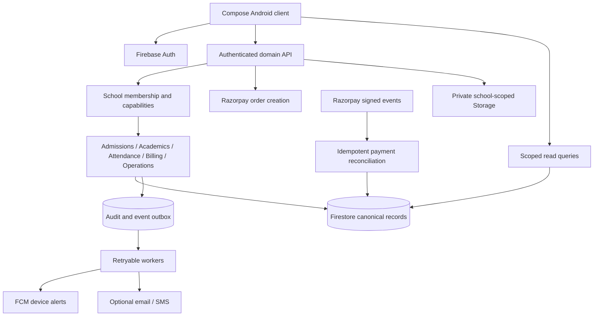

# School ERP audit and implementation roadmap

Audit date: 19 October 2026. This is an engineering assessment of the checked-out source, not a production certification. Static screen review does not establish that every page works on a device.

## Assessment

The project is a broad Android ERP prototype with a useful visual system, role-specific navigation, reusable Compose components, sample school workflows, Firebase adapters and a serverless backend. It is **not yet a complete, reliable ERP**. Adding API keys alone will not complete it. The most important gaps are authoritative data, authorization, payment reconciliation, honest failure states and end-to-end verification.

The actual client is **Kotlin + Jetpack Compose**, not Dart/Flutter. The backend is Node.js/Express on Firebase Functions. Firestore, Auth, Storage, FCM and Razorpay dependencies exist. Room, Retrofit and Firebase AI dependencies do not by themselves prove implemented offline sync, API integration or AI inference. Keep the current Android implementation for this demo. A Flutter migration is a separate product decision if iOS/web become firm requirements; it would not repair the current backend defects.

## Changes made in this pass

- Added Firebase ID-token verification with revocation checking before protected HTTP handlers, explicit route roles, claim-derived school/session scope, and denial of unknown routes. Administrative provisioning/migration/promotion require principal/admin; offline cash recording also permits accountants. No emulator authentication bypass was added.
- Prevented body fields from overriding provisioning dependencies and attributed offline receipts to the authenticated actor/session.
- Closed specific cross-school Firestore grants on students, teachers, audit, profiles and staff updates. Staff writes now check the school in the document path, not just the payload. Split delete authorization from create/update so valid scoped deletes can work.
- Prevented the broad Storage rule from overriding private student-document restrictions. Added a local Storage emulator and security regression tests.
- Replaced logging-only received-message handling with Android notification channel creation, actual private tray notifications, tap-to-open behavior, notification permission checks, support for data payloads, a monochrome icon and user permission/settings controls. Added focused Robolectric tests. This does **not** implement server dispatch, device registration or full push delivery.
- Corrected rupee labels in fees, principal dashboard and search; fixed integer division and zero-denominator handling in the analytics fee percentage and corrected paise-to-thousands conversion.
- Removed unsupported live-GPS claims; labelled illustrative analytics and scripted assistant output. These labels do not make their data production-ready.
- Separated the School Administrator from the Principal, added a fourth role-specific control-room dashboard, real module routing and an administrator navigation contract test. The role is governed by existing Firebase `ADMIN` claims and backend authorization, not by client-side persona selection in production. See [ADR-001](decisions/001-separate-school-administrator-role.md).
- Refined the shared palette from stark black/orange toward balanced slate, warm-white and muted terracotta tokens so every dashboard inherits a calmer, more professional visual hierarchy.

All changes are local. No rules/functions were deployed and no live payments were attempted.

## Prioritized findings

| Priority | Evidence | Consequence | Required implementation |
|---|---|---|---|
| P0, addressed in part | `functions/index.js` previously exposed provision, migrate, rollback, promotion and payment routes without authentication | An HTTP caller could invoke Admin SDK writes, bypassing Firestore rules | Authorization middleware added; still add request schemas, App Check, operation audit and endpoint integration tests |
| P0, specific leaks fixed | Firestore staff/admin rules lacked path tenant checks; Storage broad match also allowed student-document reads | Cross-school access and private-file disclosure | Added path checks and overlapping-match regression coverage; full field/role/privacy audit remains |
| P0, unresolved | `MainActivity.startRazorpayPayment` opens checkout without a backend order, uses USD, hardcoded contact details, and simulates success if a key is missing | A UI callback can appear to settle fees without server verification | One server-created INR order bound to a specific invoice, authoritative amount and linked student; verify settlement before displaying paid |
| P0, unresolved | Webhook and offline payment transaction bodies call `transaction.set` before `transaction.get`; webhook duplicate check is outside its transaction | Firestore transaction failures and race-prone duplicate handling | Read payment/order/invoice first inside one transaction; atomically write ledger, receipt, audit and notification outbox |
| P0, unresolved | `/createOrder` trusts client amount; missing-key path mocks orders; webhook secret has a dummy fallback | Authentication alone does not make payment settlement trustworthy | Reject invalid/negative/fractional/unsafe amounts; derive amount from invoice; require configured secrets outside isolated demo; constant-time signature verification |
| P0, unresolved | Promotion creates fees using numeric values such as 26000, while Android models use Long paise; webhook uses defaults such as 2600000 | Potential 100x amount discrepancy | One documented integer-paise contract, validated migrations and invariant tests |
| P0, unresolved | `FirebaseDataSource` starts flows with SampleData and listeners retain previous/sample data on error/empty snapshots; mutations update local state and catch cloud failures | A disconnected or rejected operation can look successful | Separate Demo and Live containers; live loading/empty/error states; await acknowledged writes; never silently fall back to demo |
| P0, unresolved | Client writes students/teachers/attendance/fees/report cards while rules deliberately deny those writes; report-card collection uses `reportCards` versus rules `report_cards` | Production CRUD/marks/attendance cannot reliably persist | Implement authenticated domain API commands and canonical collection contracts; keep sensitive writes server-only |
| P1 | `ErpDataRepository` has separate local invoices, gradebook and audit lists alongside datasource fee/report models | Different pages can show different balances, grades and history | One invoice/payment/grade source of truth; derive read models rather than maintain disconnected copies |
| P1 | Credentials provisioned from DOB/phone or fallback passwords; profile linking falls back to names/first record | Guessable access and wrong-person records | Invitation/password-reset or OTP flow, staff MFA policy, explicit membership IDs and linked child IDs; no name matching for authority |
| P1 | FCM token registration and backend notification dispatch are absent | New display code cannot produce end-to-end delivery by itself | Authenticated per-device registration, token refresh/revoke/logout handling, recipient-scoped inbox and durable outbox worker |
| P1 | Messages, complaints, leaves and notifications have broad same-school reads; all staff can access some financial data | Same-tenant privacy remains too broad | Participant/owner/class-assignment checks and capability-specific rules, including accountants/librarians/transport roles |
| P1 | `StudentDetailScreen` and `TeacherDetailScreen` fall back to the first record; teacher profile also falls back to first faculty | Missing/deleted IDs can display someone else's information; empty lists can crash | Render not-found/unlinked/permission states and require exact identity mapping |
| P1 | `ProfileScreen` advertises biometric lock, repository only toggles in-memory state | A security feature is implied without enforcement | Implement lifecycle-aware Android biometric/device credential authentication and persistent preference, or clearly mark unavailable |
| P1 | `ExamsScreen` renders schedules without filtering publication; report-card page synthesizes missing annual reports | Draft or fabricated results may appear official | Server publication gate and explicit draft/no-result states; generated samples restricted to demo |
| P2 | Fixed cohort lists, dated labels, nonfunctional export/contact actions and small/dense text | Demo credibility and usability suffer | Data-derived filters, date/session context, real action paths, accessible layouts and measured page QA |

## Screen-by-screen review register

Every screen source file is inventoried below. Review depth is static entry points, displayed claims and key data/action paths; exhaustive visual and interaction validation remains outstanding.

| File under `app/src/main/java/com/example/ui/screens/` | Current purpose | Next acceptance check / gap |
|---|---|---|
| `auth/AuthScreen.kt` | Demo role switch; live email/password login | Workspace sign-in wording does not match email/password implementation. Provisioned roles and tenant must drive access. Test expired/revoked/missing claims and logout. |
| `dashboard/PrincipalDashboardScreen.kt` | Summary, financial metrics, operational shortcuts | Local invoice/audit models need cloud authority. Rupee labels corrected; remove fixed cycle/quarter context. |
| `dashboard/AdminDashboardScreen.kt` | Operational control room for a School Administrator | New role-specific dashboard routes only to implemented modules. Complete delegated capability grants, academic setup persistence, approved change workflow and audit-detail access before customer handover. |
| `dashboard/TeacherDashboardScreen.kt` | Mentor class, schedule, student list | Remove fixed class labels/default workload values; enforce assigned classes/subjects and test teacher without a linked record. |
| `dashboard/StudentDashboardScreen.kt` | Selected student, timetable, homework | First-record fallback is unsafe in live mode; homework filters need section and membership. Provide unlinked-account state. |
| `dashboard/ParentDashboardScreen.kt` | Child selection, fees, attendance, contact | Children are inferred from names/phone and a student is synthesized if missing. Use authoritative child IDs. Teacher-connect button is a no-op. Parent role currently folds into student navigation. |
| `students/StudentListScreen.kt` | Search, cohort filters, split pane | Fixed grade options and retained selected objects need dynamic filters and refresh handling. Verify role-specific fields, pagination and add/edit/delete persistence. |
| `students/StudentDetailScreen.kt` | Student 360 tabs | Invalid ID fallback; invoice/gradebook/report sources can disagree. Verify no other student's transcript appears due to cohort matching. |
| `teachers/TeacherListScreen.kt` | Faculty directory | Verify subject search matches advertised placeholder, role access and persisted creation. |
| `teachers/TeacherDetailScreen.kt` | Faculty details and timetable | Invalid ID fallback; surname-based timetable matching can associate the wrong teacher. Use teacher ID. |
| `teachers/TeacherProfileScreen.kt` | Personal details and local photo | First-faculty fallback; photo path is local and not a cross-device asset. Limit editable fields and handle failed decoding/save. |
| `attendance/AttendanceScreen.kt` | Roll-call matrix | Initial class arguments are unused; cohorts/session slots are fixed; default present/excused values are fabricated. Save feedback appears before remote acknowledgement. Test corrections/reopening/date/session uniqueness. |
| `attendance/PrincipalAttendanceScreen.kt` | School/class/student drilldown | Missing records produce baseline percentages and imply whole-class presence. Separate today's coverage from historical rate and show unmarked classes. |
| `academics/AcademicsScreens.kt` | Timetable, homework, materials, exams | Timetable conflict checking and edit workflow need validation. Homework screen currently lists tasks without full submit/grade lifecycle. Material cards need working protected open/download. Exam drafts require role/publication gate. |
| `academics/ReportCardScreen.kt` | Student profile, annual results, certificates, PDF | Large mixed-responsibility file. Missing annual reports are synthesized. Certificates require authorized issue history, serials, revocation and honest demo watermark. Test download across supported Android versions. |
| `fees/FeeManagementScreen.kt` | Invoice lists and collection dialog | Rupee labels corrected; Stripe/Apple Pay labels still do not establish integrations. Local collection is separate from verified fee payments. Test partial, excess, duplicate, failure, cancellation and refund cases. |
| `communication/CommunicationScreens.kt` | Notices and inbox | Added device alert controls/empty inbox state. Still needs recipient authorization, per-user read state, notice audience targeting and backend push sender. |
| `operations/OperationsScreens.kt` | Hub, leave, transport, library, inventory | Transport live-GPS claim removed. Library needs borrower/copy/due-date ledger, inventory needs stock movement and custody, leave needs owner/approver rules and conflicts. |
| `reports/ReportsAnalyticsScreen.kt` | Metrics and sample charts | Fee calculation fixed and sample claims labelled. PDF export is still a no-op. Replace illustrative figures with period-scoped aggregate queries and working export. |
| `search/GlobalSearchScreen.kt` | Cross-module search | Rupee labels corrected. Search currently aggregates loaded data; restrict datasets and results by permissions and paginate on server. |
| `ai/AiAssistantScreen.kt` | Scripted response demo | Now explicitly disclosed. No verified Gemini inference. Ground future answers in scoped queries; do not feed school-wide child data to an unrestricted model. |
| `profile/ProfileScreen.kt` | Identity, app-lock switch, sign-out | App lock is not enforced; institution/version/session values are fixed. Add actual account/security settings and verify logout clears retained records/tokens. |

## Proposed system design

Use a **modular monolith** initially: one deployable backend with domain modules and stable contracts, rather than microservices. Keep Compose UI and extract screen ViewModels with lifecycle-aware state collection. Divide repository responsibilities by domain as those paths are repaired; avoid a speculative rewrite.

Design invariants:

1. School membership is verified from a token plus authoritative membership where needed; never selected from an untrusted body. A server-authorized academic-year transition has a separate validated target session.
2. Student identity stays stable across academic years. Enrollment/class/section belong to a session. Promotion creates enrollment, not a duplicate student identity or hardcoded fees.
3. Money is a safe integer number of **paise** with currency **INR**. Invoices, invoice lines, allocations, payments, refunds and receipts are distinct records. Balance is derived from immutable allocations/reversals.
4. Every critical mutation has an actor, timestamp, tenant, request/idempotency key and audit event. Publish state transitions explicitly; preserve correction history.
5. Attendance uniqueness is school + academic session + enrollment + date + period. Unmarked is distinct from absent. Finalization/correction policy belongs on the server.
6. Marks reference an assessment/subject and enrollment; validate score bounds, teacher assignment, lock state and publication version. Grade scales are school configuration.
7. Homework assignment and each student's submission are distinct entities. A class-wide boolean must not represent every student's completion.
8. Notifications have recipient-scoped records and per-user read state. Persist an event/outbox record in the domain transaction; send asynchronously with deduplication, retry and invalid-token cleanup.
9. Production starts empty/loading, never with invented people or balances. Offline writes have visible pending/failed states and explicit conflict handling.
10. Use separate demo/staging/production projects and fixtures. Customer branding, academic policies, enabled modules and fee structures are versioned school configuration rather than customer-specific source forks.

Firestore can remain the demo datastore if these contracts are enforced. For future accounting-heavy customers with complex relational reports, evaluate PostgreSQL using representative workloads and migration costs; no database replacement is justified by appearance alone.

## Missing ERP capabilities

Prioritize a coherent admissions-to-graduation lifecycle over adding disconnected menu cards:

- Organization/campus settings, academic years, classes/sections, subject allocations and permission administration.
- Admission enquiry/application, document verification, approval, enrollment, transfers, withdrawal and alumni records.
- Guardian/student linkage, staff onboarding, password recovery and membership suspension.
- Attendance calendar, holidays, period/day policies, corrections, approval and parent alerts.
- Fee plans/concessions, installment invoices, cash controls, verified gateway settlement, refunds/reversals, reconciliation and numbered receipts.
- Assessment plans, grade scales, moderation, result publication and versioned report cards.
- Homework attachments/submissions/feedback, timetable editing, teacher conflict/substitution management.
- Recipient-targeted announcements, parent-teacher conversations and complaint workflow with privacy boundaries.
- Library copy/borrower transactions, inventory stock/custody, transport assignment; actual GPS only when backed by a provider/device feed.
- Optional modules after core workflows: staff leave/payroll, purchasing, hostel, canteen, examination seating, online admissions and accounting export. Build only what the showcase/customer needs.
- CSV import with validation/dry-run, exports, backup/restore rehearsal, tenant onboarding, support diagnostics and data retention controls.

## Tools and services

| Need | Recommendation | Scope / adoption gate |
|---|---|---|
| Android UI | Keep Kotlin/Compose and existing theme tokens | Fix content and workflows before redesigning every screen. Consider a separate administrative web console later for bulk work. |
| Identity | Firebase Auth and verified custom claims | Existing dependency; repair invitations/recovery, exact user mapping and capabilities first. [Token verification](https://firebase.google.com/docs/auth/admin/verify-id-tokens). |
| Payments | Razorpay test mode | Existing dependency; finish server order/signature/reconciliation lifecycle before live credentials. [Official integration entry](https://razorpay.com/integrations/). |
| Push | Firebase Cloud Messaging | Existing dependency; implement device-token lifecycle and outbox delivery. [Android setup](https://firebase.google.com/docs/cloud-messaging/android/get-started). |
| Backend secrets | Google Secret Manager through Firebase Functions | Keep gateway secret, webhook secret and service credentials server-side. Do not place them in root Android `.env` or BuildConfig. [Secret configuration](https://firebase.google.com/docs/functions/config-env#secret_parameters). |
| App attestation | Firebase App Check with Play Integrity | Defense in depth after authentication; observe metrics before enforcement. [Android provider](https://firebase.google.com/docs/app-check/android/play-integrity-provider). |
| Reliability | Existing structured logging/Sentry backend, plus a chosen Android crash reporter | Add correlation IDs and scrub child/payment data. Avoid overlapping monitoring SDKs without a clear need. |
| Testing | Existing JUnit/Robolectric/Compose plus Firebase emulators and Node tests | Use behavior assertions, not just screenshot generation or data-class assertions. |
| Optional integrations | Email/SMS/WhatsApp, GPS/maps, accounting exports | Select after audience, delivery volume, required geography, consent, budget and demo scenario are known. No additional vendor subscriptions are required now. |
| AI | Defer live inference until scoped data is reliable | Start read-only, grounded, auditable responses. No autonomous fee, marks or student-record changes. |

Razorpay public key IDs may reach the client; secret keys and webhook signing secrets must not. Enter actual backend secrets through the secret-management flow rather than posting them in chat. The Android Secrets Gradle plugin hides values from source control, not from the APK.

## UI direction

Use the shared warm-white canvas, medium slate structure and muted terracotta action palette. Make each role's home focus on today's tasks, exceptions and next action. Keep mobile navigation to about five destinations; teacher navigation currently has six. Place secondary modules in the hub and use progressive disclosure for details. Use clear school terminology consistently (student/class/fees), explicit current school/session/child, readable touch targets, accessible contrast and large-font testing. Keep motion short and purposeful; do not use decorative 3D or looping animation that delays administrative work. Never use a green live badge for a disconnected integration. Show real loading, empty, error, pending-sync and permission states.

Before a broad redesign, capture current phone/tablet screens, test at large font size, and verify critical forms/payment dialogs do not overflow. Existing screenshots alone do not establish runtime correctness.

## Ordered implementation slices and acceptance

1. **Live identity/data foundation:** claims-based school membership, exact person/child linking, canonical naming, no sample fallback, authenticated domain writes. Accept when a teacher saves authorized attendance and another client sees it; forbidden roles/schools fail and network rejection is visible.
2. **One fee ledger:** server-created test INR order, pending checkout state, signed webhook/callback verification, atomic idempotent settlement, receipt and reconciliation. Accept duplicate/concurrent webhook, wrong amount/student/school, timeout, failed/cancelled payment and offline receipt tests. Invoice/dashboard/parent balances must agree.
3. **Notification delivery:** device registration/refresh/logout cleanup, event outbox, recipient inbox, background/foreground permission-aware display. Accept one attendance/fee/notice event delivered only to the intended user, without duplicate receipt or private lock-screen text.
4. **Academic lifecycle:** real per-student homework submission and marks moderation/publication. Accept that drafts never appear to students and missing results remain missing.
5. **Complete operational journeys:** admissions/enrollment, leave approvals, real library loans and inventory moves; validate each end-to-end before enabling its menu item in a showcase.
6. **UI/accessibility and demonstration:** polished phone/tablet flows with realistic resettable fixtures, no dead buttons, exact labels, consistent branding/currency and a rehearsed role-based demonstration.
7. **Customer-readiness:** configurable onboarding, import/export, backup/restore, observability, dependency/security review and CI gates. Load-test a declared school size and concurrent user target before setting capacity promises.

## Verification record

Latest full command: `.\gradlew.bat assembleDebug testDebugUnitTest lintDebug --console=plain` — **BUILD SUCCESSFUL**.

| Check | Final result |
|---|---|
| Debug APK | Built successfully; 29.0 MiB at `app/build/outputs/apk/debug/app-debug.apk` |
| Android JVM suite | **31/31 passed**, zero failures/errors/skips; includes the administrator-navigation contract, notification and legacy PDF storage regressions plus existing Compose preview tests |
| Android lint | **0 errors, 55 warnings**; no baseline, suppression or minSdk increase used to pass |
| Backend unit / real HTTP handler | **21/21 passed** |
| Firestore emulator rules | **86/86 passed** |
| Storage emulator rules | **14/14 passed** |
| Dependency advisories | 37 affected package entries reported; 3 critical, 3 high, 31 moderate; upgrades remain pending |
| Device smoke status | Partial pass: installed APK launched in a read-only Android emulator, entered the principal demo portal and rendered its settled dashboard. Other roles/routes and live integrations remain untested. |

APK SHA256: `DBDCDA80B09F1D2E357C988F0D5D21F2BBE3D64AD826BB106B52479AFB0CB655`.

Machine-readable results: `docs/ERP_VERIFICATION.json`. Test and lint HTML reports are under `app/build/reports`. Successful preview tests do not certify every page or constitute an asserted pixel comparison. No live payment, cloud deployment or complete FCM delivery test was performed.

The following sections preserve intermediate failures and recovery evidence; the table above is the current build/test/lint outcome.
### Additional verification and reproducibility findings

- The final Storage suite rerun also passed **12/12** after upload/delete rules were separated. The emulator emits Java runtime/shutdown warnings but the test script exits successfully.
- `npm audit --omit=dev` reported **37 affected package entries: 3 critical, 3 high, 31 moderate**, including inherited/transitive findings. These are advisory package counts, not 37 independently demonstrated exploits. Full machine-readable evidence is in `docs/ERP_DEPENDENCY_AUDIT.json`. Do not run `npm audit fix --force`; triage advisory paths and upgrade direct dependencies one at a time with regression tests.
- Backend package runtime targets Node 20; this host currently uses Node 24. Align local/CI runtime before interpreting compatibility warnings or releasing.
- The checkout lacks `.env`, `.env.example`, `app/google-services.json` and root `debug.keystore`. Android now uses committed public `secrets.defaults.properties` for demo defaults and the standard automatically managed Android debug signing configuration. Private Firebase configuration is still required for live services.
- Wrapper download failed with a socket read timeout before build execution. A checksum-verified download of the exact official distribution is being attempted; build success remains unverified until recorded explicitly.
- Repeated Firestore emulator startup attempts found port 8085 occupied. The prior 86-case pass is valid; investigate the identified local Java listener before a final rerun rather than terminate unknown processes.

- Screenshot capture now writes only to portable `app/build/reports/screenshots` outputs, rather than a developer-specific external directory or tracked source images.
- The final Firestore rerun passed **86/86** with JDK 21 after the stale workspace emulator was identified and stopped.
- Debug signing now uses the standard local Android debug certificate. Existing installations signed with another certificate may need reinstalling; register the applicable SHA fingerprint for any Firebase sign-in provider that requires it.

## Backend API compatibility after hardening

Protected requests must send `Authorization: Bearer <Firebase ID token>`. The verified token must include `uid`, an allowed role, `schoolId` and active `sessionId`. A different request `schoolId`/`sessionId` is rejected. The first administrator must be provisioned through a trusted administrative process; unauthenticated bootstrapping through `/provisionUsers` is intentionally unavailable. Client adapters/scripts that previously sent anonymous requests must be updated before deployment. Health remains public; the webhook retains its separate signature-verification path, whose unresolved settlement issues are listed above.

The current middleware is a first boundary, not complete endpoint validation. It does not yet validate parent ownership of a requested invoice, payment amount, promotion target policy or every request field. Those are explicit blockers for live payments/customer data.

### Manual acceptance script for the next device run

Use only demo accounts/fixtures until P0 items are resolved. Test principal, administrator, teacher and linked parent/student separately. For each role: login, navigate all permitted tabs, search, open missing/deleted IDs, rotate, increase font size, background/resume and logout. Verify data does not leak across roles. For the administrator, verify every control-room action lands on an allowed module and denied server writes remain denied. Mark attendance, reopen the register, change status and check totals. Create homework and verify per-student status rather than a shared flag. Exercise fee amount bounds and cancellation; verify no live payment is treated as paid from an unverified client callback. Open/download a permitted document and attempt an unrelated child's document. Send a test FCM data message in foreground and a notification payload in background with permission granted/denied. Repeat offline and after reconnect; rejected writes must never show success. Rehearse on a narrow phone and a tablet before a customer showcase.

### Review of this change

Authorization was reviewed for route casing/trailing slashes, revoked tokens, missing claims, role allowlists, tenant/session mismatch and unknown-route denial. Rules were reviewed for overlapping grants and correct delete semantics. Notification code was reviewed for permission denial, immutable launch intent, missing payloads, channel creation, private visibility and avoiding payload/token logs. Changes do not loosen server-only money/marks/attendance rules. Remaining same-school privacy, business validation, payment and notification-delivery gaps are explicitly listed and are not claimed fixed.

- Gradle bootstrap recovered: the exact 9.3.1 distribution was assembled from bounded downloads and its SHA256 matched the official published value. The Android build/unit/lint command is now running with JDK 21 and `ANDROID_HOME=D:/Android/Sdk`; this is not yet a successful-build result.

- The Gradle wrapper now pins the published Gradle 9.3.1 SHA256 and allows a 60-second network timeout. This improves repeatable bootstrap integrity without changing the selected Gradle version.

- Final backend test run: **21/21 passed**. This includes the middleware cases plus HTTP requests against the actual exported Functions handler, proving anonymous mutation requests are rejected before reaching domain handlers; health remains accessible.
- The existing Android AVD had a stale pointer. A temporary workspace-only pointer allowed a read-only x86 emulator launch, but Android did not finish booting. That audit emulator was stopped and no device interaction is claimed.

- Final Storage tests: **14/14 passed**, now including a provisioned student whose Firebase Auth UID differs from the canonical student record ID, and rejection for an unrelated student's claim.

### Application size and complexity

The dependency list includes Room, Retrofit/Moshi/OkHttp and Firebase AI, but a direct-import scan of the current Android source did not find their APIs being used. Treat these as removal/defer candidates after a dependency usage check, not evidence that the associated features work. Release shrinking is currently disabled. Measure release APK size, startup and scrolling on a low-end device; then enable and validate appropriate R8/resource shrinking and keep rules, including Razorpay behavior. Do not judge application performance from the first cold-cache debug build alone.

- The verified Gradle archive was also copied into the existing standard wrapper cache, so subsequent `gradlew.bat` runs can reuse it instead of downloading again.

- Additional attendance correctness finding: `ErpDataRepository.getStudentTodayAttendance` currently returns the first matching record without filtering by date, and returns PRESENT when no record exists. A real ERP needs an explicit unmarked state plus school-timezone/date/session filtering; a passing test that only checks a saved status does not establish today's attendance correctness.

## Android build and first test result

The debug APK was assembled successfully at `app/build/outputs/apk/debug/app-debug.apk`: **28.5 MiB**, SHA256 `AAE1BE68B6153B589D0DF11D67EF98A8CF2A8AFD440F00CC720365123835033E`.

The initial full JVM run completed 26 test entries: 9 passed and 17 failed during Robolectric setup/runtime loading. XML causes explicitly report **There is not enough space on the disk**. The system drive had about 90 MiB free while the workspace drive had over 190 GiB free. This is not a passing Android suite and does not prove the affected UI/notification behavior.

Test tasks now place JVM temporary files and the Robolectric Maven cache under the workspace build/cache directories. The already cached Android runtime was copied for reuse; personal files were not deleted. The complete Android JVM suite and lint are being rerun without skipping tests, lowering assertions or changing SDK coverage. A KSP background AWT exception was also observed, although APK compilation and packaging succeeded.

## Final Firebase rules assessment

The dedicated Firebase Security Rules Auditor assessment is in `docs/ERP_RULES_REVIEW.json`. Its overall score is **1/5** because unresolved same-school confidentiality leaks remain, despite the specific tenant-isolation fixes. Passing the regression suites does not certify the complete policy. In particular, profiles/messages/complaints/leaves need relationship checks, non-student Storage folders remain school-wide, and parent/student collection queries must match rule constraints; Firebase rules do not silently filter out unauthorized documents.

## Verified Android recovery and PDF compatibility

The existing Android JVM suite passed **28/28** after moving Robolectric artifacts to the Gradle cache without spaces. This includes all three new notification tests and the existing Compose preview tests. No tests were skipped or assertions weakened. Native-runtime extraction remains on the workspace drive.

Independent lint found two actual API compatibility errors: report/certificate export called `MediaStore.Downloads` (API 29+) without guarding the app's API 24 minimum. Both renderers now share a storage helper. Android 10+ writes a pending MediaStore PDF and publishes it only after a successful write; older Android writes into app-specific Downloads/Revenex without broad storage permission. Filenames are sanitized and failed writes are cleaned up. Success messages reflect the actual destination. Added regression tests verify legacy export bytes, directory containment and failed-write cleanup. The final build/test/lint command includes these changes and is still pending below.

The rule assessment JSON remains an explicit record of unresolved privacy and validation issues, separate from the passing regression checks. The initial failures and recovery steps above are retained as diagnostic evidence.

- Shared navigation review: the command palette currently offers administrator actions and routes without role filtering, unlike the ERP Hub. Hiding bottom-navigation items is not an authorization boundary. Add role/capability checks to route entry and command execution as well as server commands; restrict search results to the current user's permitted records.

- The expanded Android suite completed **30/30 passing**, including both PDF-storage regression tests. Lint then required the API 29 storage boundary to be expressed as a direct SDK-guarded branch; the helper was restructured without suppressing checks, increasing minSdk or changing coverage. Final verification is being rerun after that equivalent control-flow change.

## Backend runtime release gate

`functions/package.json` still declares Node 20. As of this audit date, Google's published Cloud Run runtime schedule lists Node 20 as deprecated from 30 April 2026 and scheduled for decommission on **30 October 2026**. Upgrade to a Firebase-supported maintained runtime and align local/CI tooling before backend deployment; the current host Node 24 test run is not a Node 20 or Node 22 deployment certification. See [Google's runtime schedule](https://docs.cloud.google.com/run/docs/runtime-support) and [Firebase runtime management](https://firebase.google.com/docs/functions/manage-functions). This dependency/runtime upgrade was not applied blindly during the audit.
