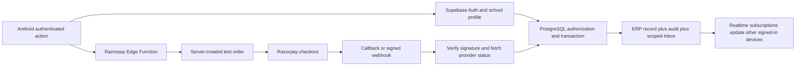

# Fix the reported hosted setup and activate action workflows

Keep passwords and all private keys out of chat, source and Android. The APK already contains only the public Supabase configuration.

## 1. Diagnose sign-in

Open `D:/VS Code/Revenex Android/supabase/diagnose_setup.sql`. Copy the full query into Supabase Dashboard > SQL Editor > New query and Run. It only reads booleans/counts.

- `teacher_auth_user_exists` false: create `teacher@revenex.demo` in Authentication > Users > Add user, choose a password locally and auto-confirm the user.
- `teacher_email_confirmed` false: confirm that synthetic demo Auth account in the dashboard.
- `provisioned_demo_profile_count` must be 4. Create the four Auth accounts in `supabase/README.md`, then run `supabase/seed.sql` to link their existing Auth IDs to school profiles. An arbitrary Gmail account or a local demo persona is not automatically a Supabase account/profile.
- If all checks pass but Auth rejects the password, reset it in the dashboard and enter that exact password on the phone. Never send it in chat.
- The new APK distinguishes rejected Auth login, missing school profile and the exact data table that failed to load. Report that fixed error text without credentials.

## 2. Apply the missing migrations

The public hosted preflight found `students` protected (401), but **razorpay_orders 404** and **razorpay-payments Edge Function 404**. Checkout cannot work against this hosted state.

After migrations 1-5, run `supabase/migrations/202610200006_razorpay_test_payments.sql` once, then `supabase/migrations/202610200007_action_workflows.sql` once. Do not rerun previously applied migrations or seed over real school data.

## 3. Deploy the payment server

Follow `supabase/RAZORPAY_SETUP.md`: set Razorpay TEST ID/secret and webhook secret directly under Edge Functions > Secrets, run `npx supabase login` locally (complete browser sign-in), then `npx supabase functions deploy razorpay-payments --project-ref nhaxnuaxyqkgnlkwpqkw` from this project folder to deploy both source files, and subscribe a signed webhook to `payment.captured` and `payment.failed`. The publishable Android key has no deployment/admin privileges.

## 4. Check the real workflow

1. Sign in as principal/admin in **Supabase Demo**. Add a student in an existing class/section. Optionally enter an initial INR fee. The form waits for database confirmation; student, invoice, audit and school notifications commit together.
2. Verify `students` and `fee_records` in Supabase. Enrollment does not create student/parent passwords or link Auth identities by guessing emails; operator provisioning/linking is separate.
3. Use the assigned seeded student/parent account for checkout testing. Fees defaults to Pending; Razorpay Test calls the server for the authorized outstanding amount.
4. Cancel: show local cancellation, no fee credit. Provider-confirmed failure: leave invoice pending and persist a failed-payment message for principal and family. Success: verify signature and captured status on server, save one receipt, notify principal and family, remove invoice from Pending while keeping it in Paid/All Invoices.
5. Keep a principal session on a second device to verify Realtime inbox and pending-list updates. Re-login and check persistence; replay webhook/callback and confirm no extra credit or duplicate failure event.

Local database and mocked-provider tests cannot prove actual hosted login, Realtime transport or Razorpay capture. These require the authenticated setup above and an actual test transaction.

## Scope

Black/orange UI is retained. No FCM, SMS/email delivery, live-money payments, refunds or production accounting is added. Teacher Auth provisioning, parent account linking, student deletion and other previously disabled cloud operations remain operator-managed; this update does not pretend every legacy module is fully writable.

## Trust and event flow

No Android callback writes a paid balance or principal notification directly. A provider failure never removes an invoice from Pending. A late capture may supersede an earlier failed attempt; a late failure cannot reverse a captured ledger entry.
